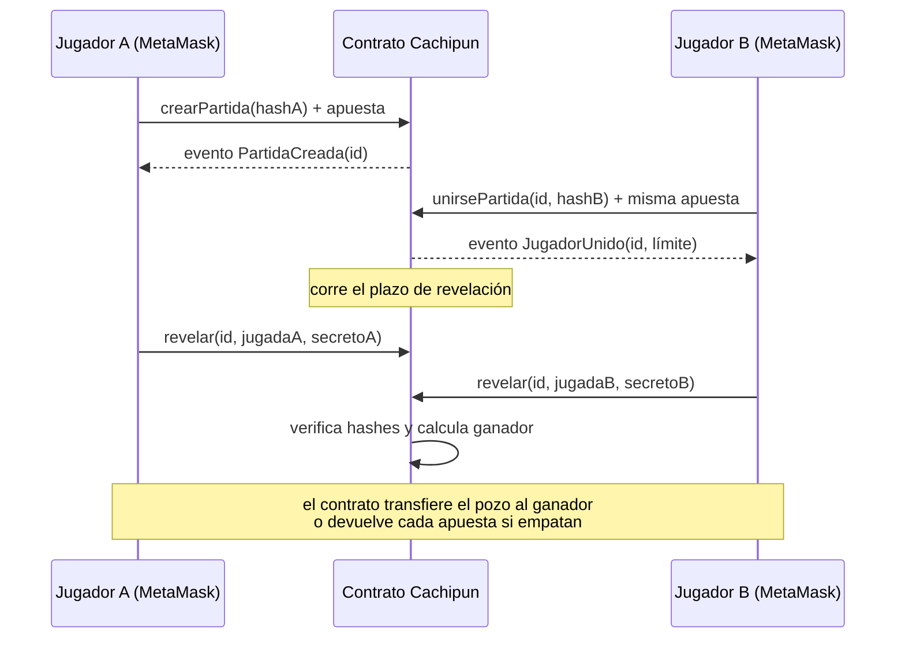

# Cachipún on-chain · BCY0010 Evaluación Parcial 2

Contrato inteligente para jugar piedra, papel o tijera entre dos personas apostando Ether, sin intermediario. Usa el esquema **commit-reveal**: cada jugador primero envía el hash de su jugada y luego la revela, de modo que nadie puede ver la jugada del rival antes de comprometer la suya.

| Dato | Valor |
|---|---|
| Integrante | Jose Veliz |
| Red | Sepolia (chainId 11155111) |
| Contrato | `0xc80660Ed1Aa19cE6cd0970CDaea8289d884E1a03` |
| Etherscan | https://sepolia.etherscan.io/address/0xc80660Ed1Aa19cE6cd0970CDaea8289d884E1a03 |
| Plazo de revelación | 300 s (parámetro del constructor) |
| Compilador | Solidity 0.8.28 o superior, EVM cancun o posterior |
| Librería | OpenZeppelin Contracts 5.x (`ReentrancyGuardTransient`) |

## Flujo



Si vence el plazo, cualquiera llama `reclamarPorTimeout(id)`:

- solo un jugador reveló → ese jugador recibe el pozo completo;
- ninguno reveló → la partida se anula y cada uno recupera su apuesta.

## Compromiso (hash)

```
compromiso = keccak256(abi.encode(direcciónDelContrato, direcciónDelJugador, jugada, secreto))
```

- `jugada`: 1 = Piedra, 2 = Papel, 3 = Tijera
- `secreto`: número aleatorio grande (30 dígitos o más), distinto en cada partida
- Se puede calcular con la consulta gratuita `calcularCompromiso(jugador, jugada, secreto)`.

Incluir la dirección del jugador hace que un compromiso copiado no le sirva a otra cuenta. Incluir la dirección del contrato evita reutilizarlo en otro despliegue.

## Estados de una partida

| Valor | Estado | Significado |
|---|---|---|
| 0 | Inexistente | id no usado |
| 1 | EsperandoRival | el creador apostó, falta el segundo jugador |
| 2 | Revelacion | ambos apostaron, corre el plazo |
| 3 | Finalizada | hubo ganador o empate y se pagó |
| 4 | Anulada | nadie reveló, se devolvieron las apuestas |
| 5 | Cancelada | el creador retiró la partida antes de que alguien se uniera |

## Funciones

| Función | Tipo | Quién | Qué hace |
|---|---|---|---|
| `crearPartida(compromiso)` | payable | cualquiera | Abre una partida; `msg.value` es la apuesta |
| `unirsePartida(id, compromiso)` | payable | cualquiera excepto el creador | Iguala la apuesta e inicia el plazo |
| `cancelarPartida(id)` | transacción | creador | Recupera la apuesta si nadie se unió |
| `revelar(id, jugada, secreto)` | transacción | jugadores | Verifica el hash; con ambas jugadas, resuelve y paga |
| `reclamarPorTimeout(id)` | transacción | cualquiera | Cierra una partida vencida |
| `retirar()` | transacción | quien tenga saldo pendiente | Retira un pago que no se pudo enviar automáticamente |
| `calcularCompromiso(jugador, jugada, secreto)` | view | — | Calcula el hash a enviar |
| `tiempoRestante(id)` | view | — | Segundos que quedan para revelar |
| `partidas(id)` | view | — | Datos completos de la partida |

## Eventos (trazabilidad)

`PartidaCreada`, `JugadorUnido`, `JugadaRevelada`, `PartidaFinalizada`, `PartidaAnulada`, `PartidaCancelada`, `PagoEnviado`, `PagoPendiente`, `Retiro`. Quedan registrados en la pestaña **Events/Logs** del contrato en Etherscan.

## Seguridad: riesgos y mitigaciones

| Riesgo | Mitigación en el contrato |
|---|---|
| Ver la jugada del rival antes de jugar | Commit-reveal: solo se publica el hash hasta que ambos apostaron |
| Cambiar de jugada después de ver la del rival | `revelar` exige que jugada + secreto reproduzcan el hash enviado |
| El perdedor no revela para bloquear el pago | Plazo fijo; al vencer, quien reveló gana el pozo |
| Nadie revela y el Ether queda atrapado | Al vencer el plazo la partida se anula y se devuelven las apuestas |
| Nadie se une a la partida | `cancelarPartida` devuelve la apuesta al creador |
| Copiar el compromiso del rival | El hash incluye la dirección del jugador y cada compromiso se acepta una sola vez |
| Adivinar el secreto por fuerza bruta (solo 3 jugadas posibles) | Secreto de 30+ dígitos aleatorios; el jugador 2 es quien podría intentarlo, por eso la responsabilidad recae en el creador |
| Reentrada al recibir Ether | Checks-Effects-Interactions + `nonReentrant` (OpenZeppelin) |
| Un ganador que rechaza el Ether bloquea la partida | Pago automático con gas limitado; si falla, queda en `pagosPendientes` y se retira con `retirar()` |
| Manipulación del tiempo | Desde The Merge el timestamp avanza 12 s por slot; el plazo de 300 s deja margen. En producción se usaría un plazo de horas |
| Ether enviado por error al contrato | No tiene `receive()`; los envíos directos se rechazan |
| Desborde aritmético | Solidity 0.8 revierte automáticamente |

## Pruebas

42 pruebas automatizadas con Foundry (incluye 1.000 ejecuciones aleatorias que verifican que el contrato nunca retiene ni pierde Ether):

```bash
forge install OpenZeppelin/openzeppelin-contracts@v5.7.0 foundry-rs/forge-std
forge test
```

Cubren las 9 combinaciones de jugadas, empate, los tres casos de timeout, cancelación, compromisos inválidos o copiados, revelación fuera de plazo, receptores que rechazan Ether o consumen todo el gas, e intento de reentrada.

## Estructura

```
contracts/Cachipun.sol      contrato
test/Cachipun.t.sol         pruebas (Foundry)
docs/GUIA_DESPLIEGUE.md     procedimiento en Remix + Sepolia y registro de evidencias
scripts/apostar.js          envía las apuestas (crearPartida / unirsePartida) desde Remix vía MetaMask
foundry.toml                configuración de Foundry
```
